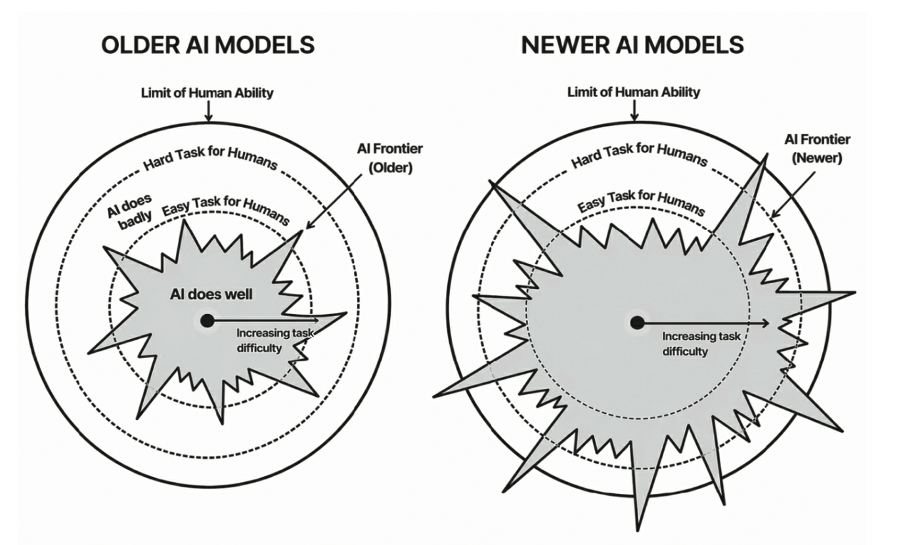

# 一場預測

2022 年，在 ChatGPT 推出前夕，一群專家被邀請預測 AI 在什麼時候能贏得國際數學奧林匹亞的金牌。預測的中位數為 2035 年，絕大多數樂觀的專家則認為是 2030 年。最終，Google 和 OpenAI 的模型都在 2025 年贏得金牌，而當初這群專家中僅有 2.3% 認為 AI 能在這個年份辦到。

# 現今的 AI 有多聰明

作者請 Claude 依照 A-I-N-O-W 造一首打油詩，Claude 僅用幾秒的時間造出：

```
AI beat clever forecasters today,

Incredible math gold, experts dismay,

Now limiting jobs

Outpacing human snobs

We question progress rapidly underway.
```

我個人跟作者都覺得這首打油詩很厲害，這也從側面顯示，目前的主流 AI 相較於 2022 年末推出的 ChatGPT，在聰明度上已經進步非常多。即使 AI 持續不斷地進化，我們仍能佔有一席之地：

1. AI 不可能在所有面向都強過我們（至少現在還不是）。
2. 即使在某些領域強過我們，它通常也會帶來讓我們產出更多價值的機會。
3. 最後，也是最重要的一點——即使這些機器變得越來越強大，我們仍然可以為工作和生活帶來一些有價值的東西。

# AI 的能力分布是「鋸齒狀」的

想像一張任務地圖，離中心越遠，代表對人類越困難。AI 能勝任的範圍卻不是平滑的圓，而是「鋸齒狀能力邊界」（Jagged Frontier）：有些人類覺得簡單的任務，AI 做不好；有些對人類很困難的任務，AI 卻能勝任。



- 作者與同事在 2023 年的顧問公司實驗中觀察到「用對任務能提升表現，用錯反而會拖累」。
- 事前難以判斷 AI 能幫上什麼忙。目前還沒有明確可循的規律，也不能只憑人類對任務難易度的直覺。
- 能力邊界持續擴張，但速度不一，不同領域的進步並不同步。

## AI 擅長與不擅長的任務舉例

- 提供不輸給經驗老道律師的專業法律諮詢 -> 擅長
- 在一場會議中保持專注 -> 不擅長
- 辨識一張圖片中有幾個特定物件 -> 不擅長
- 針對個人心理量身打造具說服力的政治論點 -> 擅長
- 對於不清楚的事情直接說不知道 -> 不擅長

## AI 會不斷吸收錯誤並自我精進

- 以西洋棋為例，即使是最頂尖的特級大師，也有 80% 的機率在一場比賽中犯下一次失誤。只要以一百位專家的棋譜訓練 AI，讓它學習「下一步最常走哪一步」，就能達到 80% 的準確率（這樣的實力已經達到中級～進階棋手的水準）。
- 它會找出在各個領域中應該信任哪一群專家，並學習他們的輸出，結合多領域的知識，去解答更艱澀的問題。
- 直覺上，我們可能認為 AI 模仿的是一個人，其實它是在模仿一個群體。

## 鋸齒狀能力邊界帶來的機會

- AI 在能力上的參差不齊使得我們和 AI 可以互相補足
- 要能有效與 AI 合作，需要避開兩個陷阱：
  - 過度自信的陷阱 -> 認為 AI 無所不能，就無條件地信任它
  - 演算法厭惡（Algorithm Aversion） -> 看到 AI 失敗一次，就認為它被高估或是存在永遠無法修復的缺陷，從此不再信任這整個領域
