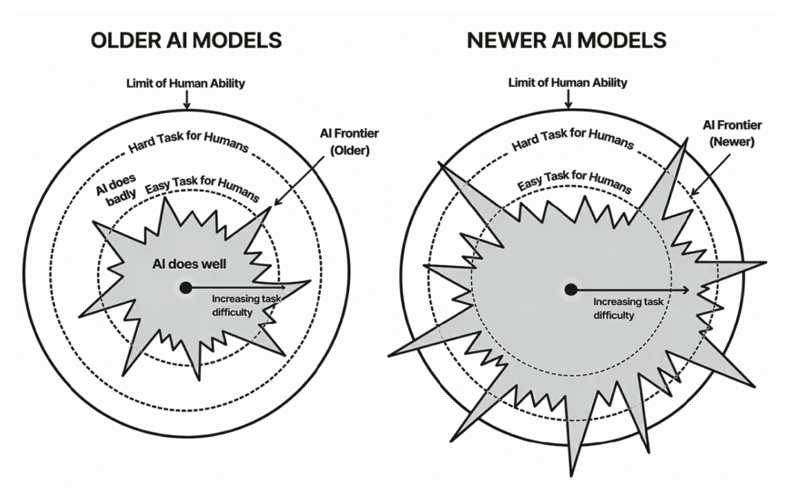

# 一場預測

2022 年，在 ChatGPT 推出前夕，一群專家被邀請預測 AI 在什麼時候能贏得國際數學奧林匹亞的金牌。中位數的預測為 2035 年，絕大多數樂觀的專家則認為是 2030 年。最終，Google 和 OpenAI 的模型都在 2025 年贏得金牌，而當初這群專家僅有 2.3% 認為 AI 能在這個年份辦到。

# 現今的 AI 有多聰明

作者請 Claude 依照 A-I-N-O-W 造一首打油詩，Claude 僅用幾秒的時間造出：

```
AI beat clever forecasters today,

Incredible math gold, experts dismay,

Now limiting jobs

Outpacing human snobs

We question progress rapidly underway.
```

我個人跟作者都覺得這個打油詩很厲害，這邊也側面描寫了目前的主流 AI 相較於 2022 年末推出的 ChatGPT 在聰明度上已經進步非常多。儘管如此，即使 AI 直到目前都不斷在進化，我們都仍能佔有一席之地：

1. AI 不可能在所有面向都強過我們（至少現在還不是）。
2. 即使在某些領域強過我們，它通常也是帶來讓我們產出更多價值的機會。
3. 最後，也是最重要的一點——即使這些機器變得越來越強大，我們仍然可以為工作和生活帶來一些有價值的東西。

# AI 的能力分布是「鋸齒狀」的

想像一張任務地圖，離中心越遠，代表對人類越困難。AI 能勝任的範圍卻不是平滑的圓，而是「鋸齒狀能力邊界」（Jagged Frontier）：有些人類覺得簡單的任務，AI 做不好；有些對人類很困難的任務，AI 卻能勝任。



- 作者與同事在 2023 年的顧問公司實驗中觀察到「用對任務能提升表現，用錯反而會拖累」。
- 事前難以判斷 AI 能幫上什麼忙。目前還沒有明確可循的規律，也不能只憑人類對任務難易度的直覺。
- 能力邊界持續擴張，但速度不一，不同領域的進步並不同步。

## AI 擅長與不擅長的任務舉例

- 提供不輸給經驗老道律師的專業法律諮詢 -> 擅長
- 在一場會議中保持專注 -> 不擅長
- 辨識一張圖片中有幾個特定物件 -> 不擅長
- 針對個人心理量身打造具說服力的政治論點 -> 擅長
- 對於不清楚的事情直接說不知道 -> 不擅長（可能部分人類也有類似情況）
