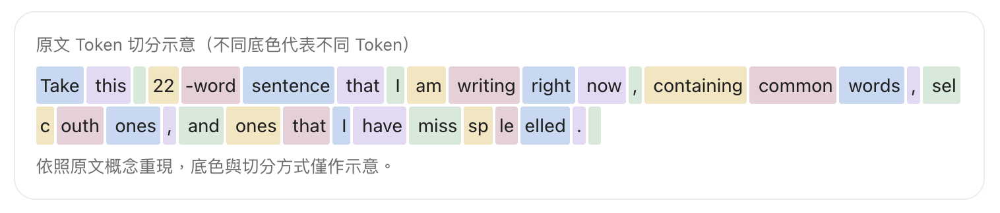
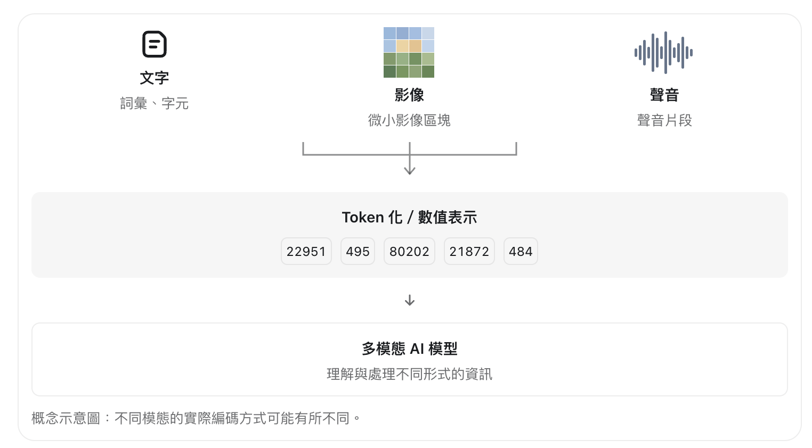

如果想讓自己更會使用 AI，就要理解 AI 如何「思考」。

在過去，所謂的「傳統 AI」追根究底，就是根據一組既有資料來預測一個數值，例如：

- 已知某位顧客的人口統計特徵，根據其他所有顧客的資料，預測這位顧客喜歡某項產品的機率有多高？
- 已知某位病人的癌症篩檢資料，根據其他所有病人的資料，預測這位病人罹患癌症的機率有多高？
- 已知某位棒球選手新人時期的數據，根據其他所有棒球選手的資料，預測這位選手成為明星球員的機率有多高？

然而，當時的 AI 卻無法做好一件看似更簡單的事：預測一句話中的下一個詞。

直到 2017 年，Google 發表的一篇論文帶來了突破，那就是鼎鼎大名的《Attention Is All You Need》。

這篇論文建立在先前的研究基礎之上，提出了一種新的 AI 形式：具有注意力機制（Attention Mechanism）的 Transformer 模型。這種模型不再只是預測一個數列中的下一個數字，而是能夠預測人類書寫文字中的下一個詞。

# 建立一個語言模型

## AI 訓練的資料從哪裡來？

首先，研究人員會蒐集大量資料來訓練 AI 模型，這些資料通常來自網路：像維基百科這類資料，使用上完全合法；Reddit 這類論壇的討論內容，則處於灰色地帶；至於從網路上下載的盜版書籍，更引發了爭議甚至訴訟——例如 Anthropic 就同意支付 15 億美元和解，也有一些 AI 公司仍在法庭上纏訟。

## Token 機制

研究人員將語言拆解成稱為「Token（詞元）」的小片段，每個片段都可以對應到一個特定的數字。現代 AI 的詞彙表大約有 20 萬個 Token（相較之下，一個成年人平均認識約 4.2 萬個單字），並能依據這套詞彙表，將較長的單字或數字拆解成多個 Token。例如下面這段話會被拆解成：



這套系統讓任何語言中的任何單字，都能透過一組有限的 Token 來表示，而每個 Token 都可以用一個數字來識別。對 AI 來說，它看到的會是：

```
[22951, 495, 220, 1709, 80202, 21872, 484, 357, 939, 5281, 1849, 1954, 11, 15683, 5355, 6391, 11, 6023, 66, 4656, 8104, 11, 326, 8104, 484, 357, 679, 5141, 82, 789, 36681, 13, 220]
```

如此一來，AI 便能對人類語言進行數學運算，再將結果轉回我們能夠理解的形式。

## 預訓練與基礎模型

在訓練階段，研究人員憑藉龐大的運算能力將這些 Token 餵給 AI，Transformer 架構便會開始找出 Token 之間的關係。例如，它會發現英文的 the 後面通常接名詞、疑問句以問號結尾；它也開始擁有「常識」，例如在「柏林是……的首都」這句話中，空白處通常會填入「德國」。AI 的核心在於預測，它根據自己曾經見過的模式，變得非常、非常擅長預測下一個 Token 是什麼。這個預訓練階段的成果，就是所謂的「基礎模型」（Base Model）。

然而，基礎模型無法直接當作 AI 助理使用。例如當你提出一個問題，它可能會回你一套陰謀論或一段威脅性的文字，因為這些內容在它的訓練資料中很常見。因此才有了「後訓練」（Post-training），讓基礎模型轉變成真正可用的東西。

後訓練大多仰賴人類的實際回饋——AI 公司向評估員提供許多可能的 AI 回覆，請他們依據一些標準為這些回覆排名，再用這些資料繼續訓練 AI，讓它更傾向給出被評為「最佳」的回答。AI 助理本質上就是一個角色，透過「強化學習」的過程，基礎模型學會扮演我們希望它扮演的角色。有些 AI 公司甚至讓使用者自行設定，讓 AI 助理扮演「正式的助理」或「友善的陪伴者」。

此外，AI 公司還運用了另一項巧妙的技術，將 Token 的概念延伸到文字以外的領域。例如，將一張圖片拆解成微小色塊、將語音切割成聲音片段，再將它們轉換為 Token。一旦完成這些轉換，AI 就能像處理文字一樣處理影像與聲音，包括看懂與生成圖片，以及聽懂與生成語音或音樂。



這些模型能夠說話、觀看、創造圖像、聆聽我們的對話，就像處理文字一樣輕鬆。

---

從 2017 年至今，大型語言模型（LLM）的本質仍然只是預測下一個 Token——我們花了數千億美元，打造出一套極其精密複雜的自動文字補全系統。
